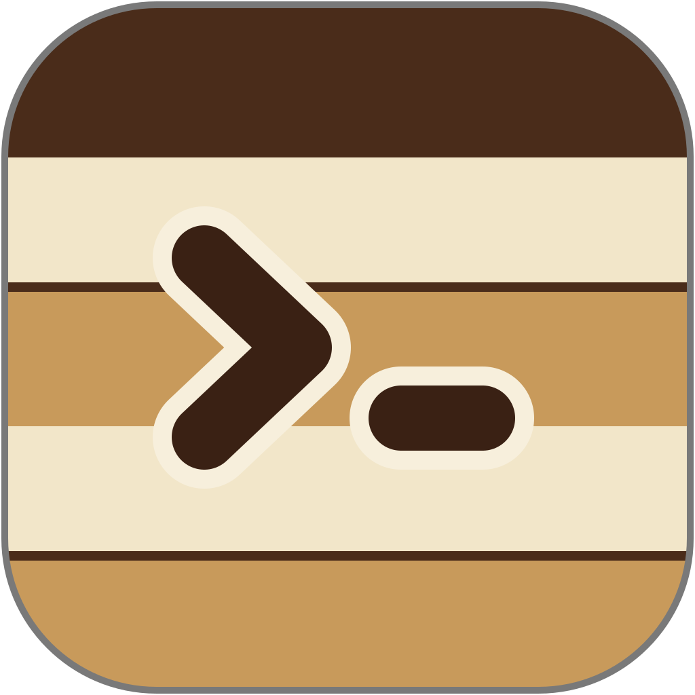
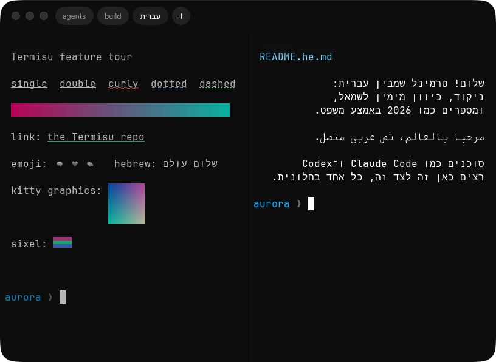
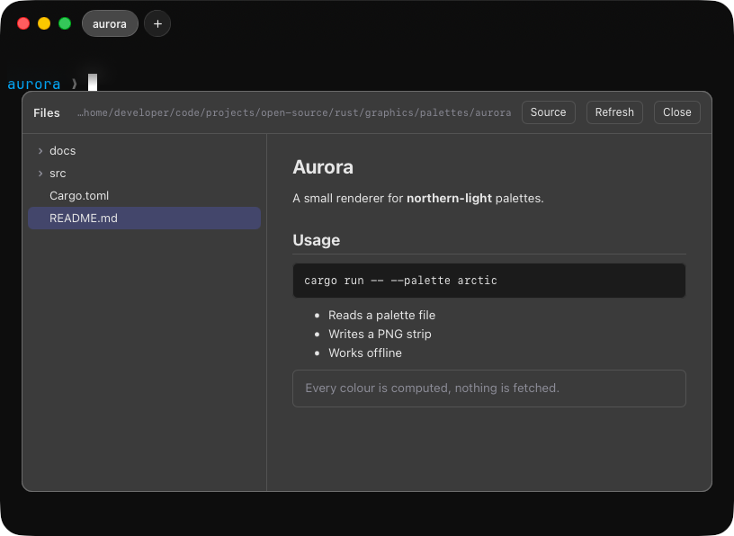

<p align="center">
  
</p>

<h1 align="center">Termisu</h1>

<p align="center">
  A native macOS terminal for multilingual text and parallel coding agents.<br>
  No account. No telemetry. Works offline.
</p>

<p align="center">
  <a href="https://github.com/Orellius/termisu/actions/workflows/rust.yml"></a>
</p>

<p align="center">
  
</p>

## What’s inside

- **Multilingual text.** Hebrew, Arabic and Latin together, with right-to-left paragraphs, Arabic shaping and Hebrew vowel marks.
- **Tabs and splits.** Tabs live in a glass island in the title bar, and every tab keeps its own split layout. The pane you are not typing into recedes, so the focused one is always obvious.
- **Motion that follows your hand.** The trackpad scrolls by the pixel, the caret glides between cells and blinks softly, and the history above the screen blurs under the tab bar instead of being cut off.
- **Coding-agent workspaces.** Launch agent CLIs, give each line of work its own Git worktree and port block, and see which tab is working or waiting for you.
- **Files from the terminal.** Cmd+click a path a program printed to open it at that line in a read-only file panel with code highlighting and rendered markdown. Turn the panel on with `panels = true` in `~/.ruuah/config.toml`.
- **Rendered on the GPU.** Metal presents every frame, so heavy output holds 60 fps. True colour, styled underlines, font ligatures, kitty graphics, sixel and monochrome emoji that fit the text.
- **Native Mac controls.** A command palette and keyboard shortcuts that keep working with a Hebrew keyboard layout.

<p align="center">
  
</p>

## Tested

- 893 Rust tests across the engine, renderer, pty and host, including pixel comparisons and round trips through the C surface the app uses.
- A differential test corpus that replays the same bytes through Termisu and Ghostty's terminal library and compares the screens.
- 18 headless smoke stages for the Swift app: layout, splits, input, selection, the file panel's offline policy and more.
- 21 tests for the web panels.

Every test has to be seen failing before it counts, against a deliberately broken build or the bug it guards. [Contributing](CONTRIBUTING.md) explains the rule and the gates.

## How it was built

I built Termisu from scratch with Claude over several weeks: an original Rust terminal
engine and a native Swift/AppKit app.

It started with a simple need: a terminal that handles Hebrew properly and makes it
easier to work with several coding agents at once. The engine, renderer and app grew
together around that.

## Build

For macOS 26 on Apple Silicon. Requires Rust 1.97.1 through `rustup`, Xcode, GNU `timeout`
(`brew install coreutils`) and `librsvg` (`brew install librsvg`).

```sh
git clone https://github.com/Orellius/termisu.git
cd termisu
./scripts/build-app.sh
```

The script builds, signs and installs `Termisu.app` to `~/Applications`.
For development setup, see [Contributing](CONTRIBUTING.md).

Pre-1.0 and under active development. Sessions do not yet survive closing the window.

[AGPL-3.0-only](LICENSE) · [Third-party notices](NOTICE) · [Security](SECURITY.md)
